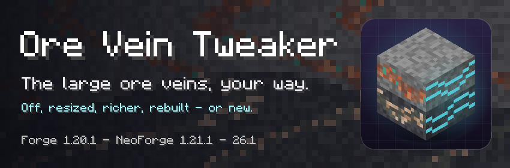
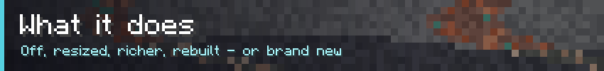
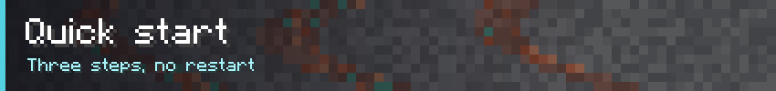
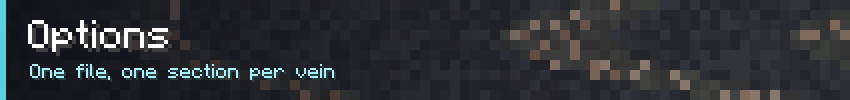
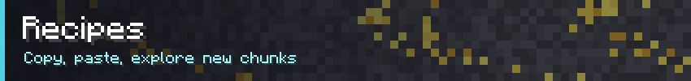
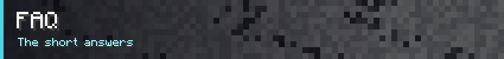
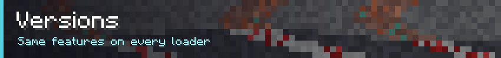

# Store copy

Paste-ready text for the CurseForge (and Modrinth) project page. Short on purpose: it sells the mod
and gets a player started; everything else - every option in detail, precision, compatibility - is in
`README.md`, which the page links to as the full guide. Every claim here is something the mod does
today; check numbers against `VeinConfig.java` / `VeinRules.java` and `CHANGELOG.md` before changing
one.

The banner and section headers are `docs/store-art/`, from `java tools/Banners.java`, linked from GitHub.


## Summary

> One line, 256 characters at most, shown under the name in every search result.

Control the large ore veins: turn iron or copper veins off, resize them, make them richer or poorer,
rebuild them from any block - or add as many new kinds of veins as you want. Plain config files, server-side only.

## Categories

Main: **World Gen**. Additional: Ores and Resources, Utility & QoL, Server Utility.

## Licence field

Custom. Point it at `LICENSE` in the repository: MIT for the code, all rights reserved for the
artwork with redistribution granted.

## Description

<!-- Everything below this line is pasted into CurseForge's Markdown editor as-is. -->



Deep underground, Minecraft hides **large ore veins**: long ribbons of copper in granite and of iron in
tuff, studded with raw ore blocks. **Ore Vein Tweaker** lets you decide what they look like.



- 🚫 **Turn them off** - iron, copper, or both
- 📏 **Resize them** - bigger and more common, or smaller and rarer
- 💎 **Richer or poorer** - more ore and raw blocks, or fewer
- 🧱 **Rebuild them** from any block of any mod - zinc veins for Create, gold veins...
- ✨ **Add new veins** - as many as you want, one small file each, at the heights you choose
- 🎲 **Mix blocks** - `"create:zinc_ore*3, minecraft:copper_ore"`: weighted palettes for ore, raw blocks and filler
- 📊 **Count your ores** - `/oreveintweaker census` shows how much of each ore is around you, even with dozens of modded ores: a short summary in the chat, a web page with everything (sortable, by mod, by height) and CSV files, and a comparison of two configs

A config file, and one small file per new vein. No datapack. **Server-side only**: players don't need it.
Works with terrain mods like Terralith and Tectonic.



1. Put the mod on your **server** - or in your mods folder for singleplayer.
2. Launch once, then open `config/oreveintweaker-common.toml`.
3. Change a value, save, and explore **new chunks**. No restart needed.

> ⚠️ Chunks that are already generated never change. Best on a new world, or as a modpack default.



`config/oreveintweaker-common.toml` tunes the two vanilla veins, `[copper]` and `[iron]`. **Every new
vein is its own small file** in `config/oreveintweaker/veins/` - as many as you want, the first launch
writes an example to copy, `/oreveintweaker reload` applies them. Every option is explained inside the
files. (Three older slots, `[extra_1]` to `[extra_3]`, still work in the main file.)

| Option | Default | Effect |
|---|---|---|
| `enabled` | `true` | `false` removes the vein |
| `size` | `1.0` | Vein volume: `2` = twice, `0.5` = half |
| `ore_amount` | `1.0` | Ore vs filler: `2` = twice the ore |
| `raw_block_amount` | `1.0` | Raw blocks: `5` = five times as many |
| `ore`, `raw_block`, `filler` | vanilla | Any block, from any mod, or a weighted list |
| `min_y`, `max_y` | none | New veins only: their height (required) |



Four complete setups, one per kind of modpack. The parts for `[copper]` and `[iron]` go in the matching
section of `config/oreveintweaker-common.toml`, in place of the same key; anything you do not paste
stays as it is. A new vein is a file of its own, named in the first line.

**⚔️ Expert pack - rare veins, each one a jackpot**
```toml
[copper]
    size = 0.5              # half as many copper veins...
    ore_amount = 2.0        # ...with twice the ore inside
    raw_block_amount = 3.0  # and three times the raw blocks
[iron]
    size = 0.4
    ore_amount = 2.5
    raw_block_amount = 3.0
```

**⚙️ Create pack - zinc gets its own veins**
```toml
# config/oreveintweaker/veins/zinc.toml
# Copper and iron stay vanilla. Zinc veins run in calcite, through the copper heights.
size = 0.8                          # a bit rarer than copper
ore = "create:zinc_ore"
raw_block = "create:raw_zinc_block"
filler = "minecraft:calcite"
min_y = 0
max_y = 70
```

**💰 Gold rush - the deep is gold and redstone**
```toml
# config/oreveintweaker-common.toml
# The iron veins become gold veins, a little poorer since gold is precious...
[iron]
    ore = "minecraft:deepslate_gold_ore"
    raw_block = "minecraft:raw_gold_block"
    ore_amount = 0.6
```
```toml
# config/oreveintweaker/veins/deep_redstone.toml
# ...and redstone veins in calcite join them, deep down.
ore = "minecraft:deepslate_redstone_ore"
raw_block = "minecraft:redstone_block"
filler = "minecraft:calcite"
min_y = -60
max_y = -20
```

**🏛️ Builder pack - huge stone bands, no free ore**
```toml
# config/oreveintweaker-common.toml
# The veins stay as wide decorative ribbons of granite and tuff...
[copper]
    size = 2.5
    ore_amount = 0.0
[iron]
    size = 2.5
    ore_amount = 0.0
```
```toml
# config/oreveintweaker/veins/dripstone.toml
# ...and a third kind of ribbon, in dripstone. The ore is required but never appears: ore_amount is 0.
size = 2.0
ore_amount = 0.0
ore = "minecraft:coal_ore"
filler = "minecraft:dripstone_block"
min_y = 0
max_y = 60
```

Shorter recipes, every option in detail and how precise the numbers are:
**[the full guide](https://github.com/DrimoZ/OreVeinTweaker#readme)**.



- **My existing world?** Only newly generated chunks change.
- **Do players need the mod?** Not on a server. In singleplayer, yes.
- **Normal iron and copper ore?** Untouched - only the large veins.
- **Other dimensions?** Large veins only generate in the Overworld.
- **Dynamic Ore Veins?** It replaces the same generator: use one or the other.
- **Modpacks?** Yes, no need to ask. Credit appreciated, never required.



| Minecraft | Loader | Java |
|---|---|---|
| 1.20.1 | Forge 47.2+ | 17 |
| 1.21.1 | NeoForge 21.1.252+ | 21 |
| 26.1.2 | NeoForge 26.1.2.112+ | 25 |

[Full guide](https://github.com/DrimoZ/OreVeinTweaker#readme) ·
[Source](https://github.com/DrimoZ/OreVeinTweaker) ·
[Report a bug](https://github.com/DrimoZ/OreVeinTweaker/issues)

<!-- End of the pasted description. -->


## Release checklist: 1.2.1

1.2.0 is published; 1.2.1 is an update of the same project (the summary and the description above
do not change, except the one line about `strip` if the page has it).

- [x] The GitHub repository `DrimoZ/OreVeinTweaker` exists and has all branches - the page links to
      its README as the full guide.
- [ ] Gallery (optional): before/after screenshots of the same seed, taken with `/oreveintweaker strip`
      (clears the stone around you so the veins show; use a throwaway world), and the census page
      (`census export`, then open the `.html` it wrote).
- [ ] Three files, release type **Release**, each with the `## 1.2.1` section of `CHANGELOG.md`
      (the jars are `oreveintweaker-1.2.1+<minecraft>.jar`, from `gradlew build` on each branch):

| File | Game version | Loader | Java |
|---|---|---|---|
| the jar built on branch `1.20.1` | 1.20.1 | Forge | 17 |
| the jar built on branch `1.21.1` | 1.21.1 | NeoForge | 21 |
| the jar built on branch `26.1` | 26.1.2 | NeoForge | 25 |

- [ ] Environment: **Server** required, **client optional** (`displayTest = "IGNORE_ALL_VERSION"`, no
      packets). Check once per loader that an unmodded client joins a server that has it.
